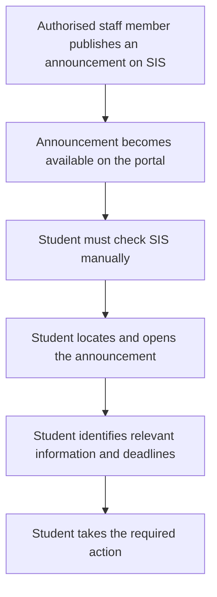
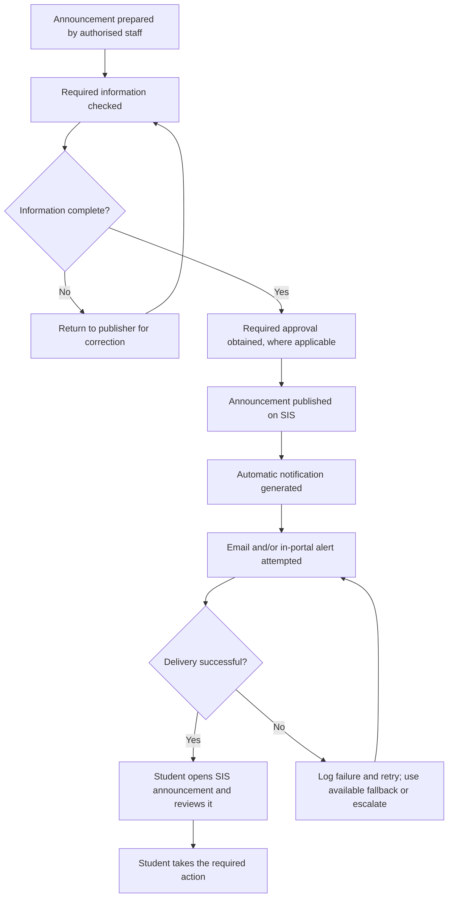

# Task 1: Investigating an ICFAI Workflow

## SIS ICFAI Portal: Academic Announcement Notifications and Deadline Management

**Author:** Tadepalli Janice Abraham

## 1. Executive Summary

The Student Information System (SIS) portal is used to access academic announcements, resources, attendance, grades and other important student-related information at ICFAI. However, based on my experience, announcements posted on the portal may go unnoticed when students are not automatically alerted to new updates. Students may need to check the portal manually and search through previously published announcements to find relevant information. The investigation focuses on how students discover announcements on SIS ICFAI, the difficulties associated with manual checking, and a proposed improvement to the process.

The proposed solution is to introduce automatic notifications when an authorised announcement is published. These notifications could be delivered through email and in-portal alerts, with push notifications considered if technically supported. The original announcement would remain accessible through SIS. This report documents the current workflow, evidence collected, identified problems, proposed improvements, five synthetic test scenarios, a measurement plan, and an illustrative estimate of time saved. The improved process has not been implemented or tested on the live SIS portal. Therefore, expected outcomes are presented as proposed results rather than verified results.

## 2. Scope and Objectives

### 2.1 Scope

The investigation focuses on the SIS ICFAI portal and the process of publishing, discovering, and reviewing academic announcements. The relevant stakeholders include faculty members, deans, the examination cell, respective Heads of Department (HODs), and students.

### 2.2 Objectives

The objectives are to:

1. Document the current announcement-discovery workflow.

2. Identify difficulties associated with manually checking SIS.

3. Maintain a dated evidence log distinguishing facts, personal experience, estimates, and assumptions.

4. Explain the problem and estimate its possible scale.

5. Propose an improved notification workflow with defined inputs, statuses, responsibilities, approval boundaries, and fallback procedures.

6. Evaluate the proposed workflow using five synthetic test scenarios.

7. Estimate net time saved after accounting for review, exceptions, and support effort.

### 2.3 Methodology

The investigation was based on my experience, along with many students using SIS ICFAI, examination of a screenshot of the announcements displayed on the portal, identification of the current process, and development of a proposed alternative workflow. The proposed workflow and synthetic cases are analytical exercises. Their expected results have not been verified through live system testing.

## 3. Evidence Collection and Current-State Workflow

### 3.1 Observed Workflow

The current process can be represented as follows:

When students do not check the portal regularly, they may discover announcements later than intended. Finding previously published information may also require additional searching. The absence of a notification is not sufficient to establish that the portal has no notification functionality under every circumstance. The current investigation documents the student-facing experience rather than the portal’s entire technical configuration.

*Figure 1: Screenshot of the SIS announcements list used as evidence (E04, E05).*

### 3.2 Current-State Problems

**Problem 1: Dependence on manual checking**

Students may need to visit SIS repeatedly to find out whether new announcements have been published, the SIS portal may mark an accidentally opened announcement as viewed.

**Problem 2: Risk of delayed discovery**

An announcement may remain unnoticed until a student next checks the portal. If it contains a deadline or time-sensitive instruction, delayed discovery may affect the student’s ability to respond promptly.

**Problem 3: Difficulty locating earlier information**

Students may need to search through existing announcements to find a particular circular or instruction.

**Problem 4: Limited visibility of unread announcements**

The screenshot examined during the investigation displays announcements with a “Viewed: ❌” status. This indicates that the displayed items are marked as not viewed in the screenshot. It does not establish why they were not viewed or whether every student has the same experience.

**Problem 5: Similar announcement titles or duplicate announcements**

The screenshot contains repeated or similarly titled notices concerning prohibited or narcotic substances. Similar titles may make it harder to distinguish announcements at a glance. The screenshot alone does not establish whether the notices are duplicates.

### 3.3 Dated Evidence Log

Evidence log date: Between 1st and 2nd weeks of October 2026

| ID | Evidence or finding | Classification | Limitation |
| --- | --- | --- | --- |
| E01 | My experience indicates that I have to check SIS manually to discover announcements. | Personal experience | Does not establish the experience of every student. |
| E02 | I have missed or discovered announcements and deadlines later than intended. | Personal experience | The total number of missed announcements has not been measured. |
| E03 | I have searched for information in previously published announcements. | Personal experience | Search time has not been measured. |
| E04 | The screenshot shows announcements marked “Viewed: ❌”. | Observed fact | Applies to the displayed items, not the entire student population. |
| E05 | The screenshot includes repeated or similarly titled notices about prohibited or narcotic substances. | Observed fact | It is not confirmed whether these notices are duplicates. |
| E06 | Manual checking may increase the risk of delayed discovery. | Inference | Requires broader measurement to determine the extent of the problem. |
| E07 | Automatic notifications may reduce repeated manual checking. | Proposed improvement | Benefit must be evaluated through testing. |
| E08 | The number of students affected and the total time lost are unknown. | Evidence limitation | Requires data collection. |
| E09 | Five synthetic scenarios have been designed to evaluate the proposed workflow. | Proposed evaluation | The scenarios have not been executed on the live system. |

### 3.4 Problem Statement

The current student-facing process depends on manually checking SIS ICFAI for new announcements. This may lead to delayed discovery, repeated searching, and additional time spent checking for updates. The extent of the problem across the student population is not yet known. The proposed improvement is to notify students automatically when relevant announcements are published, while retaining SIS as the original source of information.

### 3.5 Estimated Problem Scale

The problem can be examined at three levels:

1. Individual level: Time spent checking SIS, locating announcements, and identifying required actions.

2. Student-group level: Number of students who report delayed discovery or missed announcements.

3. Institutional level: Total number of announcements, notification failures, and student-hours spent on manual checking and searching.

## 4. Proposed Improved Notification Workflow

### 4.1 Proposed Solution

Introduce automatic notifications for announcements published on SIS ICFAI. The primary proposed channels are:

1. Email notification: A message containing the announcement title, publication time, and a link to the original SIS announcement.

2. In-portal alert: A visible alert within SIS showing that a new announcement is available.

3. Optional push notification: Considered only if the portal and institutional systems support it.

The notification should direct students to SIS rather than replace the original announcement. The announcement’s official content should remain controlled through the existing authorised process.

### 4.2 Proposed Improved Workflow

1. **Announcement preparation**  
   An authorised staff member, such as a faculty member, dean, examination-cell representative, or respective HOD, prepares an announcement.
2. **Required information check**  
   The announcement is checked for essential information, such as a title, message, relevant date or deadline where applicable, and intended audience. If a deadline is not applicable, the system should not invent one. If essential information is missing, the announcement should be returned to the authorised publisher for clarification.
3. **Approval, where required**  
   The announcement follows the institution’s applicable approval process. The exact approval hierarchy must be confirmed with ICFAI; the proposed notification feature does not independently grant publishing authority.
4. **Publication on SIS**  
   Once authorised and published, the announcement becomes available on SIS according to the portal’s existing process.
5. **Automatic notification generation**  
   The system generates an alert based on the published announcement and its intended audience.
6. **Notification delivery**  
   The system attempts to deliver the alert through the configured notification channel or channels.
7. **Student review**  
   The student receives the alert, opens the link, reviews the original announcement on SIS, and takes the required action.
8. **Exception handling**  
   If notification delivery fails, the system records the failure where logging is supported and retries according to the configured policy. An available in-portal alert serves as a fallback. If both channels fail, the issue is escalated to the designated technical support owner.

### 4.3 Workflow Diagram: simplified

### 4.4 Inputs, Statuses, Ownership, and Approval Boundaries

| Component | Proposed definition |
| --- | --- |
| Inputs | Announcement title, content, publisher identity, publication time, intended audience, and deadline if applicable |
| Initial status | Draft or awaiting required approval |
| Publication status | Published on SIS |
| Notification status | Pending, generated, sent, failed, or retried, depending on technical support |
| Student review status | Viewed or not viewed, if supported by SIS |
| Responsible content owner | Authorised staff member who prepares or publishes the announcement |
| Approval responsibility | Relevant institutional authority under the applicable approval process |
| Notification process owner | Designated SIS/IT administrator or support team, to be confirmed by the institution |
| Student responsibility | Review the announcement and complete any required action |
| Approval boundary | The notification system must not independently approve, alter, or publish content outside authorised procedures |
| Fallback | Retry notification, retain the original SIS announcement, use an available alternative alert channel, and escalate persistent failures |
### 4.5 Duplicate and Incorrect Announcements

The proposed system should flag possible duplicates using relevant details, such as the title, publisher, publication time, and announcement content. Similar titles alone should not trigger automatic deletion or rejection. If information is incorrect, the authorised publisher should correct the original announcement through the applicable institutional procedure. The notification system should not independently rewrite official information.

### 4.6 Expected Benefits

The proposed workflow is expected to:

1. Reduce the need for repeated manual checking.
2. Make new announcements easier to discover.
3. Reduce the faculty’s efforts to remind students to check the announcements.
4. Reduce time spent locating relevant notices.
5. Improve visibility of time-sensitive information.
6. Provide a clearer process for handling notification failures.
7. Preserve SIS as the primary source of official announcements.

## 5. Synthetic Testing and Expected Results

The following five synthetic scenarios evaluate how the proposed workflow should respond to common situations. They are design-level tests, not completed live-system tests.

| Test case | Synthetic input | Expected result and improvement | Recovery or control |
| --- | --- | --- | --- |
| 1. Normal announcement | An authorised publisher submits a complete announcement with a title, content, and intended audience. | The announcement is published through the authorised process and a notification is generated. Students can access the original notice through SIS. This improves awareness of new information. | If delivery fails, retry the notification and use an available fallback. |
| 2. Missing information | An announcement is submitted without required information, such as its title or a necessary deadline. | The system flags the missing field before publication or notification, where validation is supported. This reduces incomplete or unclear notices. | Return the announcement to the authorised publisher for correction. Do not invent missing information. |
| 3. Duplicate announcement | A second announcement is submitted with details similar to an existing notice. | The system flags a possible duplicate for review, reducing unnecessary repeated alerts while avoiding automatic rejection of legitimate updates. | An authorised person checks whether it is a duplicate, correction, or new announcement before proceeding. |
| 4. Unauthorised request | A user without publication permission attempts to publish or modify an announcement. | The request is rejected by the applicable access controls, protecting the integrity of official announcements. | Refer the request to an authorised publisher or administrator. Record the event if logging is supported. |
| 5. Failed notification step | An announcement is successfully published, but the email notification cannot be delivered. | The failure is identified and recorded where supported. The system retries and uses an in-portal alert if available, reducing reliance on a single delivery channel. | If the retry and fallback fail, escalate the issue to the designated technical support owner. The original SIS announcement remains available. |

Testing status: The expected results above describe how the proposed process should behave. They have not been verified on the live SIS portal. **Implementation would require testing in an approved test environment before deployment.**

### 5.1 Evaluation Criteria

1. A valid announcement triggers a notification.

2. Missing required information is flagged appropriately.

3. Possible duplicates are identified for human review.

4. Unauthorised publication attempts are blocked.

5. Notification failures trigger the configured recovery process.

6. The original announcement remains accessible through SIS.

7. Notification processing does not bypass the applicable approval process.

## 6. Time-Saving Analysis

The following calculation illustrates how automatic notifications might reduce time spent checking SIS. The values are assumptions for analysis.

### 6.1 Estimated Current Weekly Effort

| Activity | Assumption | Estimated time |
| --- | --- | --- |
| Manual portal checks | 7 checks × 2 minutes | 14 minutes |
| Reviewing announcements | 15 announcements × 1 minute | 15 minutes |
| Searching for earlier information | 8 searches × 3 minutes | 24 minutes |
| Recording deadlines or required actions | Estimated weekly effort | 10 minutes |
| Reviewing outstanding tasks | Estimated weekly effort | 5 minutes |
| Total current effort |  | 68 minutes/week |

### 6.2 Estimated Weekly Effort With the Proposed Process

| Activity | Assumption | Estimated time |
| --- | --- | --- |
| Reviewing notification summaries | 15 announcements × 30 seconds | 7.5 minutes |
| Opening and reviewing announcements | 15 announcements × 1 minute | 15 minutes |
| Recording deadlines or required actions | Estimated weekly effort | 10 minutes |
| Reviewing outstanding tasks | Estimated weekly effort | 5 minutes |
| Maintenance and support allowance | Estimated weekly effort per student | 3 minutes |
| Handling exceptions | Estimated weekly effort | 4 minutes |
| Total proposed effort |  | 44.5 minutes/week |

### 6.3 Net Time Saved

Net time saved is calculated after including the estimated review, maintenance, support, and exception-handling effort.

Net time saved = Current effort − Proposed effort

= 68 − 44.5

= 23.5 minutes per student per week

Therefore, under these illustrative assumptions, the proposed process could save approximately 23.5 minutes per student per week, equivalent to about 34.6% of the estimated current effort.

## 7. Measurement and Validation Plan

To determine whether the proposed process improves the current workflow, the following plan is recommended.

**Stage 1: Establish a baseline**

Record portal-check frequency, time spent reviewing announcements, time spent searching for earlier information, and the number of delayed or missed announcements over a defined period.

**Stage 2: Conduct a controlled pilot**

If approved by the institution, test the proposed workflow in a suitable test environment or with a limited group of authorised users and participating students.

**Stage 3: Measure notification performance**

Record the number of announcements published, notifications generated, successful delivery attempts, failures, retries, and fallback activations, where the technical system supports these records.

**Stage 4: Compare student effort**

Compare the baseline with the pilot using the same measurement period and equivalent activities. Include the time spent reviewing notifications and handling exceptions.

**Stage 5: Calculate net savings**

Calculate the difference between baseline effort and pilot effort, including review, maintenance, support, and exception-handling costs.

**Stage 6: Review limitations**

Document the number of participants, announcement volume, missing data, technical issues, and any factors that could affect the results.

## 8. Implementation Plan

| Phase | Activity | Responsibility |
| --- | --- | --- |
| 1. Review | Confirm the current SIS capabilities and notification limitations | Designated SIS/IT team |
| 2. Approval | Confirm institutional permissions, content approval requirements, and notification policy | Relevant institutional authorities |
| 3. Design | Define notification content, audiences, statuses, and fallback rules | SIS/IT team with relevant stakeholders |
| 4. Development | Configure or develop the notification feature if technically feasible | Authorised technical team |
| 5. Testing | Run the five synthetic test cases in an approved environment | Technical team and designated reviewers |
| 6. Pilot | Evaluate the workflow with an approved group | Relevant stakeholders |
| 7. Review | Compare time spent and notification performance against the baseline | Designated project owner |
| 8. Deployment decision | Decide whether to implement more widely based on results | Institutional decision-makers |

## 9. Limitations

1. The current-state analysis is based on personal experience and the available screenshot.

2. The number of students affected by delayed announcement discovery is unknown.

3. The technical architecture and existing notification configuration of SIS have not been independently verified.

4. The exact institutional approval hierarchy for different announcement types has not been confirmed.

5. The five synthetic scenarios have not been executed on the live system.

6. The time-saving figures are illustrative assumptions rather than measured results.

7. The feasibility and cost of introducing email or in-portal notifications require technical assessment.

## 10. Recommendations and Conclusion

The investigation identifies a potential problem in the SIS ICFAI announcement-discovery process: students may need to check the portal manually and search for earlier information, increasing the risk of delayed discovery and unnecessary effort. The recommended improvement is to introduce automatic notifications linked to announcements published through the authorised SIS process. Email and in-portal alerts should be considered as the primary channels, with clear handling for missing information, possible duplicates, unauthorised requests, and failed notification delivery. Before implementation, the institution should confirm the current portal capabilities, relevant approval procedures, and technical ownership. A controlled pilot should then be used to assess notification reliability, student experience, and actual net time saved. The estimated saving of 23.5 minutes per student per week is an illustrative projection, not a verified result. Measuring the existing process and comparing it with a pilot would establish whether the proposed improvement produces meaningful benefits. Overall, the proposed workflow aims to make academic announcements easier to discover, reduce avoidable manual effort, and preserve the integrity of official information published through SIS ICFAI.

